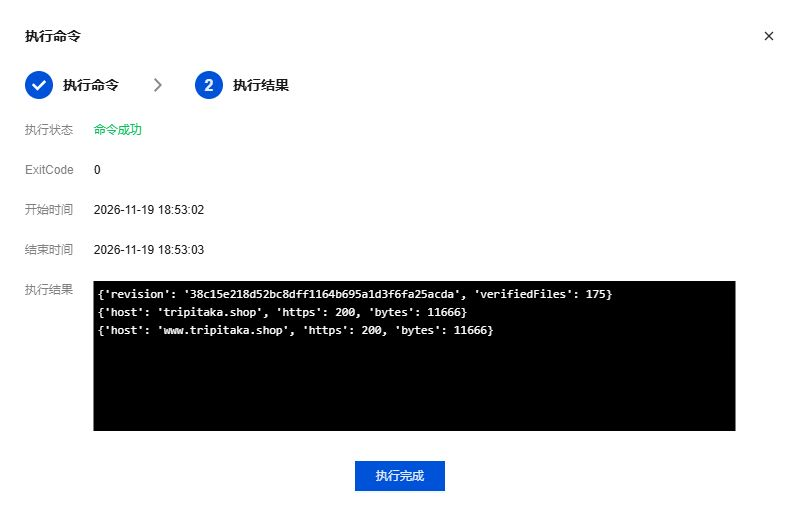
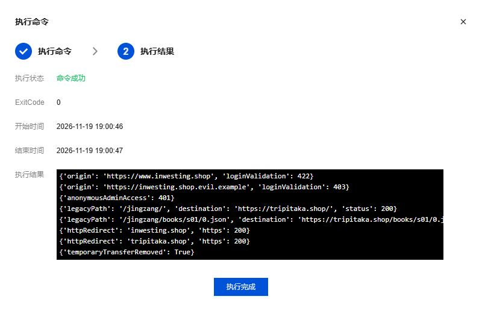
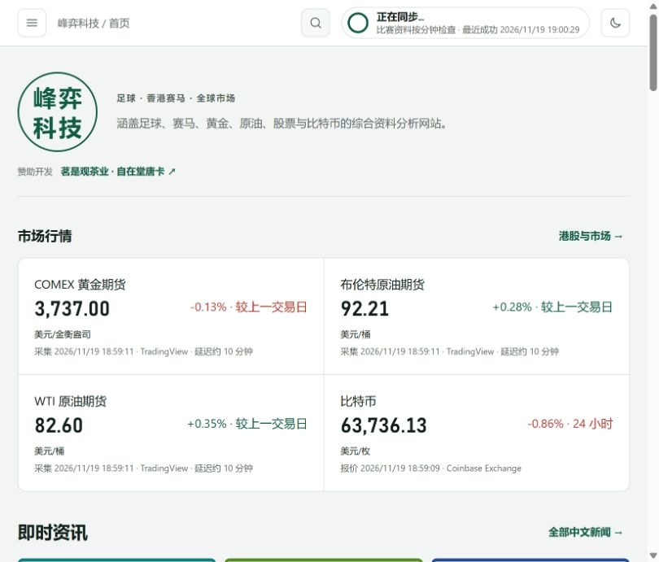

# 独立域名与文化站部署

## 部署目标

依据用户要求，将完整投资与体育网站绑定到新域名并保留原服务器；经藏文化使用另一新域名，部署到新购买的香港服务器。

| 网站 | 域名 | 腾讯云实例 | 公网地址 | 配置 |
| --- | --- | --- | --- | --- |
| 峰弈科技 · 投资与体育 | inwesting.shop、www.inwesting.shop | lhins-ic5x2807 | 43.161.235.216 | 香港，4 核 / 8GB |
| 经藏文化 | tripitaka.shop、www.tripitaka.shop | lhins-66drfydl | 43.161.202.209 | 香港，2 核 / 4GB |

`inwesting.shop` 为腾讯云账户中实际注册的拼写，含字母 w。原 `footballknow.art` 与 `www.footballknow.art` 保留；原 `/jingzang/` 地址以 308 跳转到文化站，并保留后续路径。所有域名启用 Caddy 自动 HTTPS。

DNSPod 为两个域名分别配置根域名与 www 的 A 记录，TTL 600 秒。文化服务器仅增加 TCP 80、443 网站访问端口，保留原有 SSH 和 ICMP 规则。已有 Hermes 服务仍只监听本机端口；原 Caddy 默认欢迎页配置保留。

## 源码与数据

- 投资站：`footballknow/`，运行目录 `/opt/footballknow`，私人配置仍位于 `/var/lib/footballknow`。
- 文化站：`footballknow/public/jingzang/`，54 部书籍、4,833 个目录章节；发布目录 `/srv/jingzang/releases/<commit>`，当前版本链接 `/srv/jingzang/current`。
- 投资站左侧“经藏文化”指向 `https://tripitaka.shop/`；文化站顶部“峰弈科技”返回 `https://inwesting.shop/`。
- 管理员登录的来源白名单同时接受新旧投资域名的 HTTPS 地址。文化域名不获得投资后台的跨站写入权限。
- 迁移不更改管理员账号、密码、DeepSeek 设置或后台同步开关。收藏和阅读进度仍是浏览器按域名保存的数据，换域名不会自动复制旧域名的本机记录。

## 发布步骤

每次固定 GitHub 提交及下载包 SHA-256，验证后再部署。先发布文化站，确认新域名可以阅读，再更新投资站的链接及跳转。

文化站使用 `footballknow/deploy/install-culture.py`：

```sh
python3 install-culture.py \
  --archive release.tar.gz \
  --sha256 <下载包SHA256> \
  --revision <完整提交SHA> \
  --caddy-base-sha256 <当前Caddyfile的SHA256>
```

安装器只读取文化站公开文件及 `deploy/Caddyfile.culture`，检查目录路径、文件大小、书籍分卷及章节数。将文化站独立配置附加到原 Caddyfile，先验证配置、备份，再切换当前版本链接并重新加载 Caddy。原有服务配置及 Hermes 程序不改动。

文化站备份位置为 `/var/backups/jingzang/<UTC时间>/`，包括原 `Caddyfile` 与原版本链接。`/jingzang-release.json` 记录本次提交、包校验值与各公开文件校验值。若重新加载失败，安装器恢复原 Caddy 配置和当前版本链接。

投资站使用已有 `footballknow/deploy/update.py`，额外传入 `--caddy-base-sha256` 才允许更新域名配置。更新器保留私人目录以及比发布包更新的线上数据快照；完成后检查五项赛事接口，并记录公开 `release.json`。

## 手动恢复

先确认目标实例和备份时间，不能把两台服务器的配置混用。文化站恢复时，用对应备份的 `Caddyfile` 覆盖配置，校验通过后重新加载；将 `/srv/jingzang/current` 原子切换回 `previous.json` 记录的旧版本。首次部署没有旧版本时，恢复旧配置即可。投资站按已有[腾讯云部署与恢复](腾讯云部署与恢复.md)操作。

## 验证记录

发布前：19 项后台测试通过，包括新旧四个 HTTPS 来源登录、Secure 会话 Cookie、拒绝 HTTP 和伪造域名、后台同步权限。Python 编译、差异空白检查、凭据扫描通过。固定 GitHub 包经两个部署器验证，包含 3,789 个投资站发布文件、175 个文化站公开文件。

- 源码版本：`38c15e218d52bc8dff1164b695a1d3f6fa25acda`。
- GitHub 下载包 SHA-256：`463a406e16ba15e222ee8dcedd47a75577b31fa475534e03c0bf3df843e3e645`，59,110,193 字节。
- 文化服务器发布时间：2026-11-19 18:50（UTC+8）；备份 `/var/backups/jingzang/20261119T105048`。
- 文化站 175 个文件与清单逐一校验一致。香港服务器按正常域名请求 `https://tripitaka.shop/` 和 `https://www.tripitaka.shop/`，均返回 200，并通过默认 TLS 证书验证及页面内容检查。
- Google 公共 DNS 的 HTTPS 查询与香港服务器解析均返回预期公网 IP。当前操作电脑的本地解析尚返回找不到域名；因此本机浏览器对新域名的实际页面交互暂未通过，不将服务器的请求检查写成浏览器验收。
- 投资服务器发布完成时间：2026-11-19 19:00（UTC+8）；备份 `/var/backups/footballknow/expanded-38c15e218d52-20261119T110021`。更新 2,977 个文件，其余较新的线上数据按更新器规则保留；web、worker、Caddy 三项服务均为 active。
- 首次从 GitHub 下载在 240 秒超时，未进入安装阶段。随后使用文化服务器临时中转同一公开 GitHub 包，校验值不变；成功发布后已删除文化站的临时中转包。
- `inwesting.shop`、`www.inwesting.shop`、`footballknow.art`、`www.footballknow.art` 的 HTTPS 首页均返回 200，包含峰弈科技页面和新文化域名链接；投资站公开版本清单与上述源码提交一致。
- 新投资域名的两种 HTTPS 来源能进入登录参数校验（空表单按预期返回 422），伪造相似域名被拒绝（403），匿名读取后台同步控制被拒绝（401）。现有管理员账号未在该次线上检查中实际登录；完整成功登录及 Cookie 行为由隔离测试账号覆盖。
- 原 `/jingzang/` 及 `/jingzang/books/s01/0.json` 都跳到文化站的对应路径并返回 200；《史记》第一分卷的 44 个章节读取成功。两个新域名的 HTTP 请求均自动跳到 HTTPS。
- 浏览器实际打开原主站，首页资料完成载入，导航“经藏文化”的链接已指向 `https://tripitaka.shop/`。新域名本机解析问题已单独说明，并请用户用手机移动网络复核。

### 验收截图






