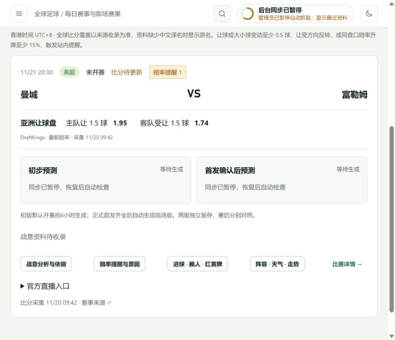

# 两阶段足球自动预测与晨操备战观察

## 使用入口

- 每日赛事 `/#/live`：选择“五大联赛 · 自动预测”，每场固定显示“初步预测”和“首发确认后预测”。覆盖英超、西甲、意甲、德甲、法甲；原有欧冠入口保留。
- 比赛中心：本场分析同样读取这份预测，不重复调用模型。
- 赛马详情：新增“晨操备战与降班观察”；马匹档案的晨操页可展开评分及逐日训练依据。

## 自动执行

`worker.py` 新增 `football-forecasts`，默认每60秒检查，使用原有 DeepSeek 私密配置。初版在开赛前6小时内生成；临场版只在开赛前90分钟内、双方均有11名不同且来源明确标注的首发时生成。后台到点排队执行，不要求用户打开网页。

每轮至多处理两项，初版和临场版都有队列机会。到期预测优先获得空闲工作位，不提高全局并发上限。资料未齐稍后检查；模型错误按次数延后重试。并发领取有10分钟租约，防止网页刷新或进程重启重复调用。管理员关闭同步时不生成、不继续抓取；打开后自动检查尚未开赛的比赛。已开赛不补写。

新部署首次补做当天初版可在服务器服务环境执行：`python sync_football_forecasts.py --bootstrap-day YYYY-MM-DD`。日期按香港自然日，次数仍受每轮两项限制；可重复执行直至队列处理完。此参数只影响这一次，不改变以后6小时的触发时间。

## 数据及记录

仅接受近期取得的赛程、赛前研究和最新亚洲让球盘。阵容需匹配赛事编号、主客队及开球时间，缓存回退信息不能冒充最新确认首发。盘口过时、滚球或只有开盘时，不生成实际亚洲盘选边，比分预测仍可独立保留。

初版和临场版分别固定保存，标明生成时间、采用的盘口/赔率、模型、资料时间和快照摘要。完整事实输入保存在私有 `football-forecasts.sqlite3`，公开接口只返回成稿及必要依据。赛事改期或换对手时匹配身份改变，旧报告不当作新赛程预测。赛果更新时分别计算精确比分、胜平负方向及亚洲盘赢/赢半/走/输半/输；四分之一盘拆分相邻两条半球盘。取消、中断或尚未核对的90分钟赛果不计算。

比分基线使用双方最近最多10场、至少3场有效完场往绩，近期权重逐场乘0.85，同主客场再乘1.2。本方加权进球与对方加权失球平均后限制在0.2至4.5，用独立泊松分布列出候选比分。来源杯赛完场比分可能含加时，属于粗略参考；不是经过训练或校准的概率模型。DeepSeek结合阵容、近期战绩、天气、盘口和旧版预测输出简短结论及可展开依据。不用提示词长度宣称预测准确率。

## 晨操与降班观察

近7天与此前14天按每周折算比较快操、试闸、操练日及恢复活动，排除重复记录、比赛当日、未来和出赛记录。记录不足、超过48小时未更新或类别未核对时标为资料不足，不把缺记录当少训练。采集日前已完整覆盖的日期才参与比较；评分往绩使用独立赛前截止日期。

降班观察展示最近三次已收录赛前评分、当前评分、距下一班标准上限的差距，并跟踪下一次实际编班。标准边界取自[马会评分政策](https://www.hkjc.com/chinese/racinginfo/handicap_policy.asp)。训练减少也可能是赛后恢复或休整，公开记录不能证明有意减分或输马。第五班明确没有标准更低班次。

赛前观察在私有状态目录保存；赛后只核对已有赛前存档。没有存档时显示回看观察，不算原预测。赛马 AI 输入采用同一份备战及评分依据。

## 发布核验

完整回归：Python 217项通过，JavaScript 102项通过。覆盖首发不足/重复/身份不符、过期及未来资料、开球后拒绝新增、改期、暂停恢复、重试去重、初版先于临场版、四分之一盘结算和中文名称映射。测试使用隔离状态和模拟模型响应，未消耗真实模型额度。

本地浏览器已核对每日赛事两阶段位置、比赛中心共用记录、暂停同步的提示，以及390像素视口下两卡片改为纵向排列，没有页面横向溢出。晨操页核对香港精神的21天观察窗、两段训练统计及实际三场评分29/31/33。比赛名称不同但双方中文标签及开球时间完全相同且匹配唯一时合并，修复曼城等比赛重复显示。浏览器控制台未发现错误。

验证截图为本地暂停同步环境，不代表已经上线或已经调用真实模型。

生产发布继续使用既有带备份及回滚的更新器；保留管理员、DeepSeek密钥、同步开关和已有报告。文化站不在本次更新范围。实际线上发布状态另行补记。

本次发布准备时腾讯云仍显示微信登录页。尚未执行服务器更新、尚未为今天比赛生成真实 DeepSeek 预测。密钥只保存在服务器私有目录，本机不含该密钥。
