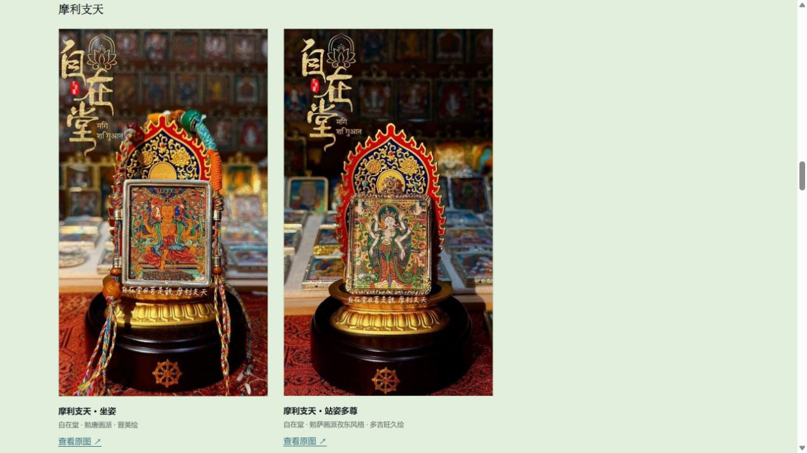

# 经藏自在堂唐卡照片配对

站主提供的九张原图，按自在堂官网作品目录和原始商品图片核对。完整照片与品牌水印保留，原 PNG 可点击打开；网页使用同尺寸的无损 WebP，按需加载。没有相应照片的宝帐怙主、五姓财神保留知识文字和官方链接，不挪用其他尊像填充空框。

## 逐张配对

| 上传顺序 | 原文件标识 | 网站图名 | 页面条目 | 官方作品编号 |
| --- | --- | --- | --- | --- |
| 1 | b8ddb6a3-bf55-4e43-81ff-a7e43299c4db | zz-shuiyue-guanyin | 水月观音 | 808 |
| 2 | cfaba4eb-b603-4d8d-adf6-4ff4560178f6 | zz-marici-seated | 摩利支天·坐姿 | 1052 |
| 3 | ed807cb5-767c-408c-acf7-40d96b8da499 | zz-marici-standing | 摩利支天·站姿多尊 | 1051 |
| 4 | 673bf0b2-0432-44d1-a108-ffe9893f2cf3 | zz-yamantaka | 大威德金刚·多尊 | 1047 |
| 5 | 492307f9-d050-428c-8f69-2ea9e7724aeb | zz-six-armed-mahakala | 六臂玛哈嘎拉（大黑天） | 1045 |
| 6 | b9eb7e8a-84da-428a-99c8-131ca1259a38 | zz-western-three-saints | 西方三圣·极乐世界 | 1044 |
| 7 | fe0470e9-abd2-4be3-a672-a79bfab68b6c | zz-five-faced-black-avalokiteshvara | 五面黑观音（新增条目） | 1041 |
| 8 | b7b2288d-b3bb-4d52-b8ef-2ba1954fdee8 | zz-manjushri-triad | 文殊三尊（三怙主） | 1040 |
| 9 | acece708-3814-4bb5-b29b-7b738b99acc3 | zz-white-manjushri | 白文殊 | 1037 |

## 核对依据

[自在堂作品目录](https://msgart.com/ldcms/fuwuanli.html)将每幅缩略图与作品名称、详情链接关联。详情网址格式为 `https://msgart.com/ldcms/fuwuanli/<编号>.html`。

第 1—8 张和各自官方目录图片的 RGB 像素逐一完全一致。第 9 张与官方白文殊图片尺寸同为 1914 × 3402，存在小幅色彩差异，逐通道平均绝对差为 2.246 / 0.946 / 0.625（0—255）；浏览器另核对人物、莲上剑与经书、画框、背景、水印，确认同幅照片。

第 7 张必须匹配官方 1041「五面黑观音」，不是 1024「宝帐怙主」，也不是第 5 张的六臂玛哈嘎拉。此项通过官方 1041 图片与上传图逐像素一致确认。新增介绍限于作品题名、画师、画派及画面可见特征，不照搬商业页面的功效和收藏价值宣传。

## 发布检查

2026-11-21 13:26:50（香港时间）发布到文化站独立服务器 `lhins-66drfydl`，正式地址为 `https://tripitaka.shop/#zang`。源码版本 `8ed83808540a8c994a995970d9ffc03243aecc2c`；发布包提交 `912c4343a83acdb4d325bdd443ee168c1ce3c113`，已推送 GitHub。

完整发布包为 131,452,195 字节，按 `00`、`01`、`02` 顺序合并 `releases/culture-tangka-8ed83808.tar.gz.part-*` 即可恢复。完整包 SHA-256：`a6638d7b7713efe98734f65e54a62011cfeb1f5cd4bde7dbf9a137dc315ba2f2`。安装前检查现有版本、网站配置摘要及发布包摘要，按既有安装器校验全部经文章节，随后原子切换版本。回退资料保存在 `/var/backups/jingzang/20261121T052650`。

服务器校验 205 个文化站文件全部一致，包含 9 张唐卡原 PNG、9 张对应 WebP 和此前的 8 张茶页照片；Caddy 与独立访问计数服务均正常。经文、音频播放器和访问计数状态未作变更。

验证结果：

- 九张 PNG 与站主附件的 SHA-256 一致；无损 WebP 保留原尺寸，逐一核对透明通道及叠在白、黑背景上的可见像素，九张全部一致。总传输体积由 47,415,938 字节减为 27,737,210 字节，节省约 41.5%，使用懒加载。
- `node --check`、`git diff --check` 通过；安装器本地读取发布包确认 205 个文件和全部经文章节完整。
- 桌面浏览器正式网页九张图片均已加载，并使用对应 WebP；两幅摩利支天分别配坐姿、站姿图注，五面黑观音使用独立条目。
- 390 × 844 的手机视口下图片为单列、宽度 348 像素，页面宽度与视口均为 390，没有横向溢出。

