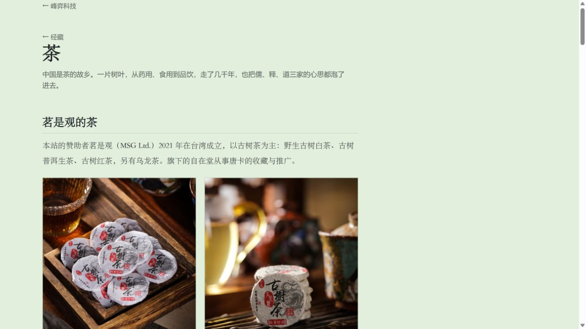

# 经藏茶页图片补充

站主于 2026-11-21 提供八张原图，用于 tripitaka.shop 的「茶」页面。图片原样保存到 `footballknow/public/jingzang/images/cha/`，不修改证书、奖章或产品内容。

## 页面内容

- 四张茶品照片：古树茶小饼、茶饼与茶席、茶丸与茶汤、茶饼礼盒。
- 两张 2022 年奖章：International Taste Institute 三星、Monde Selection 金奖。
- 一张 2025 年野生古树白茶的 Monde Selection 特金奖证书。
- 一张 2022—2025 年获奖年表。

茶品展示放在茶页开头。全部图片提供新窗口原图链接，证书与年表完整显示；窄屏茶品和证书采用单列，奖章保持两列。图注不将未确认品种的产品图标成特定茶款。奖项介绍依据站主提供的证书及年表。

原先没有素材的茶树、采茶和其他茶类空框移除，相关知识正文保留。投资站其他页面、经文及播放器无此项改动。

## 发布与验收

发布目标为经藏独立文化服务器 `lhins-66drfydl`（香港，2 核 / 4 GB），公网地址 `https://tripitaka.shop/#cha`。使用版本化目录与原子链接切换，保留前一版本以便回退；不覆盖访问计数状态。

2026-11-21 12:58:36（香港时间）已发布版本 `435cc455c9645a2026183bbdcceb97c4531e787b`。发布包 `releases/culture-tea-435cc455.tar.gz` 的 SHA-256 为 `df9c24ce4756ef3b2b83c9baca1ade4e5c8143a019ca448b2d5d3943d88f2e9e`，服务器逐一校验 187 个文件一致，Caddy 与独立计数服务均正常。回退记录保存在 `/var/backups/jingzang/20261121T045836`。

检查结果：JavaScript 语法及差异空白检查通过；正式浏览器页面 8 张图片均已加载，奖章、礼盒和证书使用完整适配显示；证书原图返回 1103 × 1617 像素。390 像素手机宽度下茶品、证书均为单列，页面没有横向溢出。保留经文与已有朗读功能的原文件。

